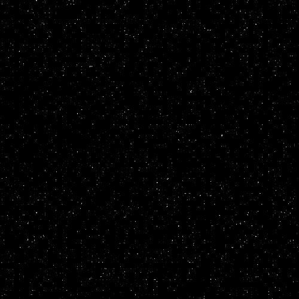

<!-- 
  ========================================================================
  🌌 GUIA RÁPIDO PARA O BANNER DE TOPO:
  1. Crie uma pasta chamada "assets" no seu repositório de perfil.
  2. Coloque um GIF ou imagem de estrelas lá dentro (ex: "starsSky.gif").
  ========================================================================
-->

  <!-- Banner Animado de Topo com Efeito de Fade -->
  

    

  <!-- Título Estelar -->
  <h1>🌌 Olá, viajante! Eu sou o Gustavo 🚀</h1>

  <!-- Texto Digitável Estilizado -->
  

    
  

---

### 🛰️ Central de Comando (Sobre mim)

  Perfil orientado a projetos (<em>hands-on</em>), com experiência prática na construção de sistemas completos — frontend, backend, autenticação, banco de dados em nuvem e processamento de dados.
    
  🔭 <strong>Atualmente em órbita focando em:</strong>
  <ul>
    <li>✨ Desenvolvimento Web Fullstack (Next.js & TypeScript)</li>
    <li>⚡ Automações e análise de dados com Python & Flask</li>
    <li>🌌 Interfaces modernas, responsivas e performáticas</li>
  </ul>

---

### 💻 Tecnologias de Bordo

   
  
✨ <strong>Linguagens</strong> ✨

  
  
  
  
  

  
✨ <strong>Frameworks & Bibliotecas</strong> ✨

  
  
  

  
✨ <strong>Banco de Dados & Backend</strong> ✨

  
  

  
✨ <strong>Ferramentas de Voo</strong> ✨

  
  
  

---

### 🌠 Missões em Destaque

<table>
  <tr>
    <td width="50%" valign="top" style="background: rgba(26, 26, 64, 0.4); border-radius: 8px; padding: 15px;">
      <h3>🎵 Dashboard de Partituras</h3>
      

        Plataforma web para organização, gerenciamento inteligente e estudo de partituras musicais.
      

      

        <strong>Stack:</strong> Next.js · TypeScript · Supabase
      

      

        • Autenticação de usuários 
        • Banco de dados em nuvem 
        • Interface moderna e responsiva
      

    </td>
    <td width="50%" valign="top" style="background: rgba(26, 26, 64, 0.4); border-radius: 8px; padding: 15px;">
      <h3>📊 youtubeAnalys</h3>
      

        Aplicação fullstack para buscar dados de playlists do YouTube, processar metadados e gerar análises visuais.
      

      

        <strong>Stack:</strong> Python (Flask) · JavaScript · Chart.js · IA
      

      

        • Coleta e processamento de metadados 
        • Visualizações interativas 
        • Integração com inteligência artificial
      

    </td>
  </tr>
</table>

---

### 📡 Telemetria e Contato

  
🌌 <em>Estou em órbita aberto a oportunidades como Desenvolvedor Júnior / Estagiário. Vamos cruzar a galáxia juntos?</em> 🌌

   

  
  &nbsp;
  

    

  <!-- Estatísticas com tema noturno cósmico -->
  

    

  

---

  <!-- Rodapé com ondas estelares -->
  
  
 ✨ <em>Que a força e o código limpo estejam com o seu deploy!</em> ✨

